# TinyML 实验手册

## 从散点数据到 MCU 端四分类推理：ESP32 + TFLite Micro + TFT 实时显示

---

## 0. 实验概览

本实验完整走一遍 TinyML 的工程闭环：在画布上手工点出四簇样本 → 在云端训练一个 388 参数的全连接网络 → 转成 TFLite 并嵌入固件 → 在 Wokwi 里用两个滑动电位器模拟温湿度、实时驱动一块 TFT 屏显示四类环境状态。

实验项目名：**环境监测-模拟温湿度**。两个电位器分别代替温度与湿度传感器，ESP32 端完成推理，结果显示在 ILI9341 屏幕上。

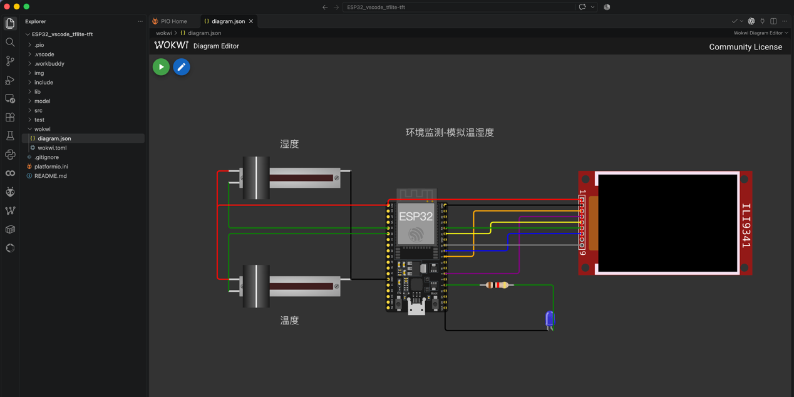

*图 0-1　Wokwi Diagram Editor 中的完整电路：上方电位器模拟「湿度」，下方电位器模拟「温度」，ESP32 负责推理，右侧 ILI9341 显示结果*

| 项目 | 内容 |
|---|---|
| 实验类型 | 综合设计型（环境搭建 → 数据 → 训练 → 转换 → 部署 → 验证 全流程） |
| 建议学时 | 5 学时（1 学时环境搭建 + 2 学时训练与导出 + 2 学时固件与联调） |
| 硬件平台 | ESP32 DevKitC V4 + ILI9341 TFT(SPI) + 2×滑动电位器 + LED |
| 软件环境 | VS Code + PlatformIO + Wokwi 仿真；Google Colab（或本地 Jupyter）训练 |
| 最终成果 | 两个电位器作为「虚拟传感器」，ESP32 端实时输出四类状态概率，TFT 屏显示当前类别与四条概率条 |
| 前置知识 | C/C++ 基础、Python 基础、听过「神经网络 = 多层矩阵乘加」即可 |

### 四类语义

| 类别 | 含义 | 屏幕显示 | 颜色 |
|---|---|---|---|
| a | 潮湿舒适 | `WET COMFORT` | 绿 |
| b | 潮湿闷热 | `WET HOT` | 红 |
| c | 干燥舒适 | `DRY COMFORT` | 青 |
| d | 干燥偏热 | `DRY HOT` | 橙 |

两个特征轴的含义：

- **x 轴 = 温度**：值越大越热（左=舒适，右=热）
- **y 轴 = 湿度**：值越大越潮（上=潮湿，下=干燥）

### 你需要交付什么

1. 一个能编译通过的 PlatformIO 工程（`src/` 下含 `main.cpp`、`model.h`、`scaler.h`）。
2. 一份 `wokwi/` 配置，能在仿真里稳定跑出四类结果。
3. 一份实验报告（要求见 §8）。

---

## 1. 实验目的

1. 理解端侧设备从“数据采集”向“智能决策”转型 
2. 掌握将一个轻量化模型（TinyML）的训练、转换并部署到 MCU 的完整链路，理解「训练端」与「部署端」的分工边界。
3. 理解**归一化参数是模型的一部分**：`mean/scale` 与权重必须同源，否则精度静默崩塌。
4. 会在资源受限设备上做**内存预算**（模型体积、张量竞技场、RAM/Flash 占用）。
5. 能独立完成开发环境搭建：VS Code 插件、PlatformIO 工程、Wokwi 仿真配置、Colab 训练环境。

---

## 2. 实验原理

### 2.1 TinyML 五步流程

```
① 采集数据        ② 训练模型          ③ 转换              ④ 部署            ⑤ 验证
   画布上点四簇  →  16-16-4 全连接  →  Keras→TFLite     →  转 C 数组        →  电位器扫全场
   (0~1023 坐标)    StandardScaler     float32 / int8      TFLite Micro       混淆矩阵/屏显
```

关键点：**第 ③ 步之后模型就"冻结"了**。此后任何预处理（归一化）都必须与训练时逐位一致，否则模型本身没错、结果却全错。

### 2.2 「虚拟传感器」的设计

真实 TinyML 项目用温湿度传感器采数据；本实验用**两个滑动电位器**代替，好处是可以手动、连续、可重复地扫过整个输入空间，便于观察决策边界。

| 环节 | 数值范围 | 说明 |
|---|---|---|
| 训练数据（画布坐标） | 0 ~ 1023 | `ScatterWidget` 画布固定范围 |
| ESP32 ADC | **必须设成 10 bit** | 默认 12 bit 是 0~4095，量纲不一致会导致结果全错 |
| 归一化后 | 均值 0、标准差 1 | `(raw - mean) / scale` |

> ⚠️ 这是本实验**最容易犯又最难发现**的错误：只改 `analogReadResolution(10)` 一处，忘了就全错。


### 2.3 归一化为什么必须同源

`StandardScaler` 在训练集上拟合出两个向量：

```
mean  = [μx, μy]     每一维的均值
scale = [σx, σy]     每一维的标准差
```

它们和权重一样，**是模型的一部分**。MCU 端必须用同一组数做 `(raw - mean) / scale`。

反例：某同学训练时 `mean=[413.77, 197.79]`，部署时手抄了上一版模型的 `[260.43, 138.62]`。程序不报错、串口有输出、LED 会亮，但四类概率完全错乱 —— 这是**静默失败**，只能靠"归一化参数与模型同源"这条纪律避免。

本实验用 Notebook 自动导出 `scaler.h`，杜绝手抄。

### 2.4 资源预算

| 项目 | 数值 | 说明 |
|---|---|---|
| 参数量 | 388 个 | 2×16 + 16 + 16×16 + 16 + 16×4 + 4 |
| 模型体积 | 3744 B | float32、未量化 |
| 张量竞技场 | 16 KB | TFLite Micro 的临时内存池 |
| 实测 RAM 占用 | 44184 B / 327680 B（13.5%） | 含竞技场与框架 |
| 实测 Flash 占用 | 572861 B / 1310720 B（43.7%） | 含 TFLM 运行时 |
| 单次推理耗时 | 屏显 `infer x.xx ms` | 实际值随编译选项浮动 |

---

## 3. 实验环境

### 3.1 硬件清单

| 器件 | 数量 | 说明 |
|---|---|---|
| ESP32 DevKitC V4（或兼容 30/38 pin 开发板） | 1 | 主控 |
| ILI9341 TFT 模块（240×320，SPI） | 1 | 显示推理结果 |
| 滑动电位器模块 | 2 | 模拟温度与湿度两个通道 |
| 电阻 1 kΩ | 1 | LED 限流 |
| LED | 1 | 类别指示灯（可选） |

> 仿真阶段以上器件全部由 Wokwi 虚拟提供，**不必先买硬件**；到阶段 D 接真机时再准备实物。

### 3.2 软件安装

本实验只需三样东西：**VS Code**（编辑器）、**PlatformIO**（编译烧写）、**Wokwi**（电路与运行仿真）。三者都是 VS Code 插件，装完即可离线跑通全流程。

**1）安装 VS Code**

从 [code.visualstudio.com](https://code.visualstudio.com/) 下载安装，Windows / macOS / Linux 均可。

**2）安装 PlatformIO 与 Wokwi 插件**

打开 VS Code，左侧点扩展图标（四个方块），搜索 `PlatformIO IDE` 安装；再搜 `Wokwi Simulator` 安装。

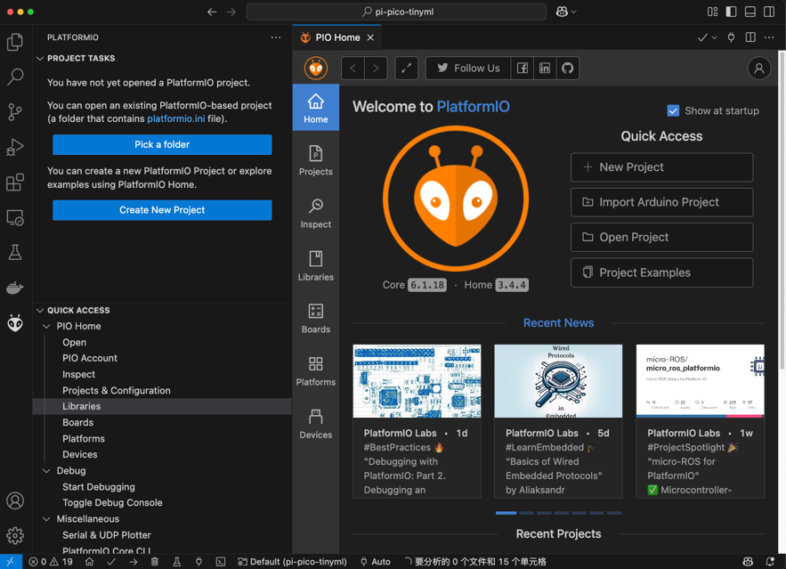

*图 3-1　在扩展面板搜索并安装 PlatformIO IDE 与 Wokwi Simulator（两者都装完需重启 VS Code）*

**3）确认插件生效**

装完重启后，VS Code 左侧活动栏会出现一个蚂蚁图标（PlatformIO 主页）。点开能看到 `PIO Home` 即成功。

> PlatformIO 首次启动会自动下载 ESP32 工具链（约 200 MB），耗时取决于网络。如果卡在 `Installing...`，可稍等或按 §6 故障 1 排查。

### 3.3 版本要求

| 软件 | 版本要求 | 备注 |
|---|---|---|
| VS Code | 任意较新版本 | 需装 PlatformIO IDE 与 Wokwi 扩展 |
| PlatformIO Core | 6.2.0（本机实测） | |
| **espressif32 平台** | **6.6.0（必须锁定）** | 见 §6 故障 1 |
| Adafruit ILI9341 / GFX | 1.7.0 / 1.13.0 | 由 PlatformIO 自动拉取 |
| ArduTFLite | 1.0.2 | TFLite Micro 的 Arduino 封装 |
| Python | 3.9+ | 需 tensorflow、scikit-learn、drawdata、seaborn |

### 3.4 工程结构

```
ESP32_vscode_tflite-tft/
├── platformio.ini          # 环境与依赖
├── src/
│   ├── main.cpp            # 固件主程序
│   ├── model.h             # 模型 C 数组（Notebook 导出）
│   └── scaler.h            # 归一化参数（Notebook 导出）
├── wokwi/
│   ├── diagram.json        # 电路连接
│   └── wokwi.toml          # 仿真固件路径
├── docs/
│   ├── 实验手册.md          # 本文档
│   └── images/             # 文档插图
└── .pio/                   # 编译产物（自动生成，不用手改）
```

---

## 4. 实验步骤

整个实验分五个阶段，建议按顺序推进：

| 阶段 | 内容 | 产出 |
|---|---|---|
| 0 | 环境搭建与工程创建 | 空的 PlatformIO 工程 + `wokwi/` 配置 |
| A | 数据采集与训练 | 训练好的 Keras 模型 + 评估图 |
| B | 模型导出 | `model.h`、`scaler.h` |
| C | 固件移植 | 可编译的 `main.cpp` + `platformio.ini` |
| D | 电路连接与仿真 | 四类结果在 TFT 上稳定复现 |

### 阶段 0：环境搭建与工程创建

**0.1 新建 PlatformIO 工程**

点左侧蚂蚁图标打开 `PIO Home` → `New Project`，填写：

| 字段 | 取值 |
|---|---|
| Name | 自取，例如 `PicoTinyML`（截图中的工程名仅作示例） |
| Board | **Espressif ESP32 Dev Module** |
| Framework | **Arduino** |
| Location | 默认（或勾选"使用已有目录"） |

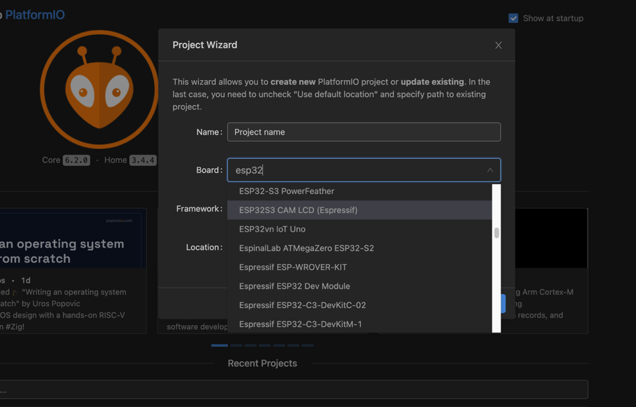

*图 4-1　Project Wizard 中 Board 必须选 Espressif ESP32 Dev Module，Framework 选 Arduino*

点 `Finish`，PlatformIO 会自动生成工程骨架，并在后台拉取 ESP32 平台包。

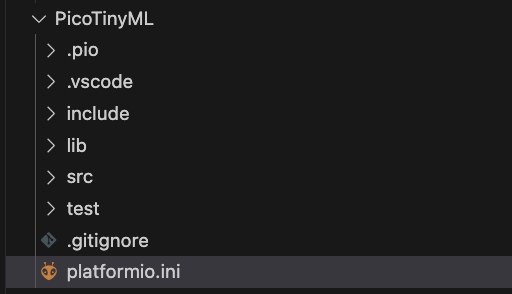

*图 4-2　生成后的目录：`include/` `lib/` `src/` `test/` 与 `platformio.ini`。日常只改 `src/` 和 `platformio.ini`*

**0.2 建立 wokwi 目录**

在工程根目录右键 → 新建文件夹，命名为 `wokwi`。里面要放两个文件：`diagram.json`（电路）和 `wokwi.toml`（固件路径）。

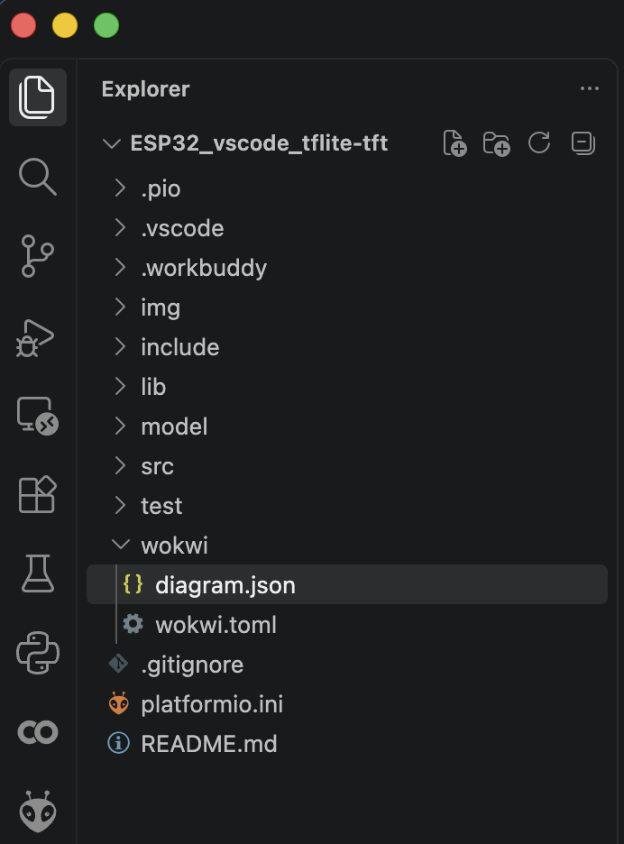

*图 4-3　`wokwi/` 下必须且只需 `diagram.json` 与 `wokwi.toml` 两个文件*

**0.3 准备 diagram.json**

本工程已提供可直接使用的 `wokwi/diagram.json`（元件与连线要点见附录 D），把它拷进 `wokwi/` 目录即可，不必从零手画。

如果确实要手工编辑，注意**不要用图形编辑器改连线**——图形编辑器会把坐标改乱，反而不如直接改文本：

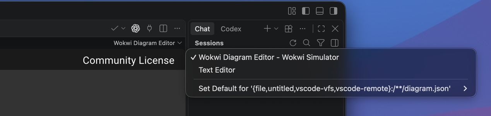

*图 4-4　点 `diagram.json` 标签页标题处的下拉箭头，选择 Text Editor 直接改 JSON*

旧版本 VS Code 没有这个下拉箭头，可以右键标签页 → `重新打开编辑器的方式`：

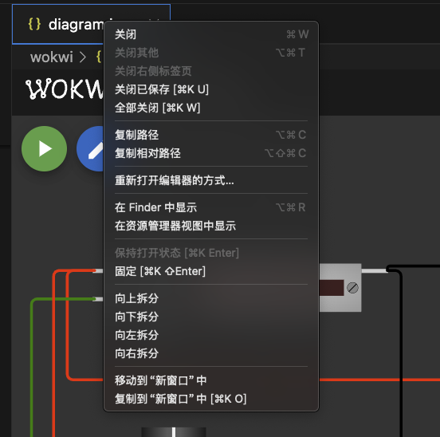

*图 4-5　命令面板里的 Wokwi 相关命令：Start Simulator / Text Editor*

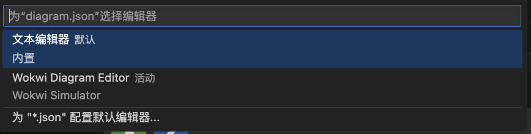

*图 4-6　右键标签页选择「重新打开编辑器的方式」，再选 Text Editor*

**0.4 编写 wokwi.toml**

```toml
[wokwi]
version = 1
firmware = '../.pio/build/esp32dev/firmware.bin'
elf      = '../.pio/build/esp32dev/firmware.elf'
rfc2217ServerPort = 4000
```

> 路径必须相对 `wokwi/` 目录、指向 `.pio/build/esp32dev/`。写错的最典型症状是仿真启动后提示找不到固件，或跑的是上一次的旧固件。**ESP32 用 `.bin`，不是 `.uf2`**（那是 RP2040 的格式）。

### 阶段 A：数据采集与训练（Colab）

本阶段在 Notebook 里完成。推荐用 Google Colab，本地 Jupyter 也可以。

**A1. 认识 .ipynb**

`.ipynb` 是 Jupyter Notebook 的文件格式，把代码、说明文字（Markdown）、公式、可视化和运行结果放在同一个交互式文档里，广泛用于数据分析、机器学习和教学。

打开 / 编辑 `.ipynb` 有两种方式：

- **本地环境（推荐，无需联网）**
  1. 安装 Jupyter Notebook；
  2. 或 JupyterLab（更现代的界面，兼容 `.ipynb`）；
  3. 或 VS Code：装 Jupyter 扩展后直接打开、运行 `.ipynb`。
- **在线环境（无需安装）**
  1. Google Colab（免费，带 GPU/TPU）：<https://colab.research.google.com/>
  2. Kaggle Notebooks（免费，带数据集）：<https://www.kaggle.com/notebooks>
  3. Jupyter Notebook 在线版：<https://jupyter.org/try-jupyter/>

后续步骤以 Colab 为例。

**A2. 把 Notebook 放进 Google 云盘**

Colab 平台是 Google 提供的免费云端计算机，既能写笔记，也能跑代码训练模型。注册 Google 账号即获得一个云端硬盘，访问 <https://drive.google.com/> 进入。

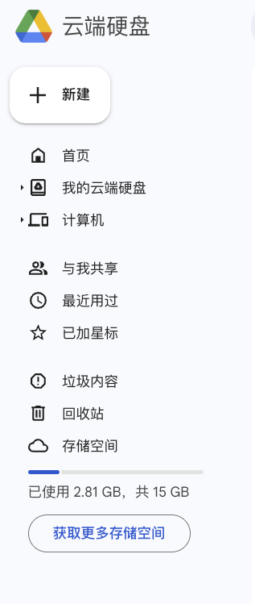

*图 4-7　云端硬盘首页。Colab 中创建的笔记本默认也保存在这里*

在云盘首页点「新建」，选择「新建文件夹」：

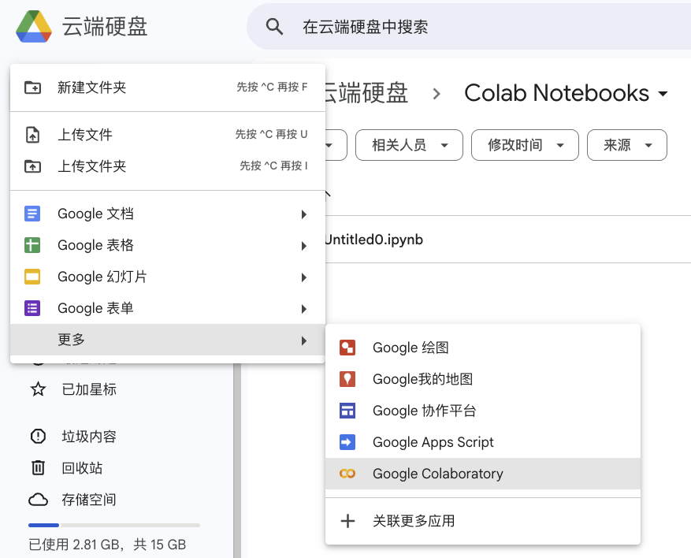

*图 4-8　「新建」菜单：新建文件夹、上传文件、上传文件夹。展开「更多」里的 Google Colaboratory 可直接新建笔记本*

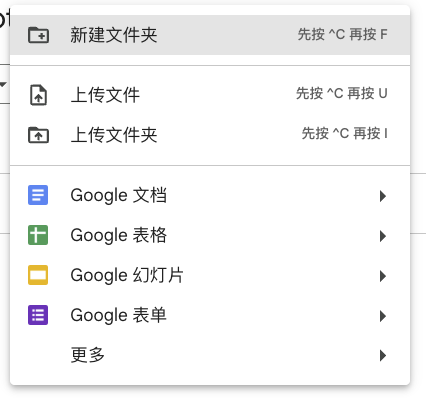

*图 4-9　新建一个 `Colab Notebooks` 文件夹，把 `code_copper.ipynb` 上传进去*

**A3. 在 Colab 中打开并连接运行时**

右键 `code_copper.ipynb` → 用 Google Colaboratory 打开。首次打开点右上角「连接」，等待分配运行时（Runtime）。

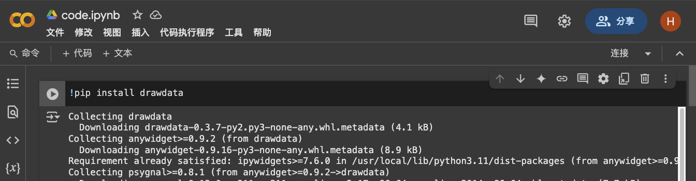

*图 4-10　Colab 顶部菜单：文件 / 编辑 / 查看 / 插入 / 运行时 / 工具 / 帮助。右侧为连接状态*

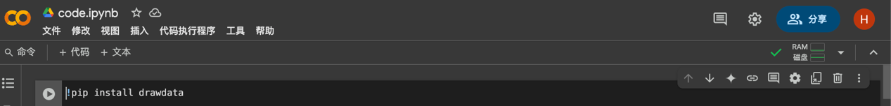

*图 4-11　工具栏上的 `+ 代码`、`+ 文本`、连接、全部运行等按钮*

**A4. 采集四簇数据**

依次执行 Notebook 的单元（`Shift+Enter`）。第一个可交互单元是 `drawdata` 画布，需要手工点出四簇样本：

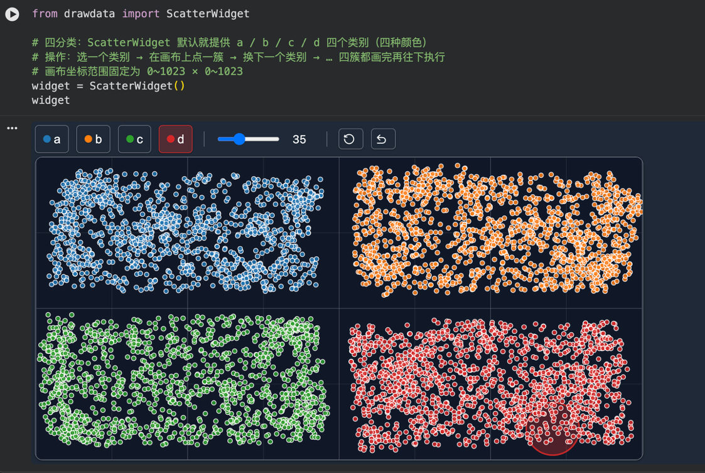

*图 4-12　在画布上依次选择 a / b / c / d 并各自点出一簇（截图样本数 52/55/52/54）*

```python
!pip install drawdata
from drawdata import ScatterWidget
widget = ScatterWidget()
```

画布默认提供 a / b / c / d 四类（蓝/橙/绿/红）。**必须先在上方单选框切到 c、d 各点一簇**，否则后面全会"正常跑完"但只有两类。

> 要求：每类 **≥ 15 个点**，四簇之间留出明显间隔，方便观察决策边界。

**A5. 标签映射与自检**

```python
label2num = {'a':0, 'b':1, 'c':2, 'd':3}
num2label = {0:'a', 1:'b', 2:'c', 3:'d'}
df["target"] = df["label"].map(label2num)

present = set(df['label'].unique())
missing = sorted(set(label2num) - present)
assert not missing, f'画布上缺少类别 {missing}！请补齐 c、d 两簇'
assert df['label'].value_counts().min() >= 10, '有类别样本过少，建议每类 ≥ 15'
```

Notebook 内置四道断言（数据、标签、模型输出层、训练集类别），**任何一道报错都不要绕过，它是唯一能拦住"静默变二分类"的关卡**。

**A6. 切分与标准化**

```python
X_train, X_test, y_train, y_test = train_test_split(
    X, y, test_size=0.2, random_state=47, stratify=y)

scaler = StandardScaler()
X_train = scaler.fit_transform(X_train)   # 只在训练集上 fit
X_test  = scaler.transform(X_test)        # 测试集只 transform
```

`stratify=y` 保证四类在训练/测试集里比例一致；统计量只在训练集上拟合，避免数据泄漏。

**A7. 建模**

```python
model = Sequential([
    Input(shape=(2,)),
    Dense(16, activation='relu'),
    Dense(16, activation='relu'),
    Dense(4,  activation='softmax'),   # ← 四分类的根
])
```

隐藏层用 16/16 而不是 8/4：四类的边界比二类复杂，容量太小会欠拟合。388 个参数对 MCU 来说仍然微不足道。

**A8. 训练**

```python
model.compile(optimizer='adam',
              loss='sparse_categorical_crossentropy',
              metrics=['accuracy'])
early_stop = EarlyStopping(monitor='val_loss', patience=30,
                           restore_best_weights=True)
history = model.fit(X_train, y_train, epochs=300, batch_size=32,
                    validation_data=(X_test, y_test), callbacks=[early_stop])
```

**A9. 评估（三项都要看）**

1. loss / accuracy 曲线（分两张子图，量纲不同不能共轴）
2. **混淆矩阵**（4×4）：看是哪两类互相混淆
3. **决策区域图**：`argmax` 后按类别填色，直观检查边界是否合理

**A10. 记录本组参数（后面抄进报告）**

```python
print(scaler.mean_, scaler.scale_)   # 归一化参数
print(model.count_params())          # 参数量
```

### 阶段 B：模型导出

**B1. 转 TFLite**

```python
converter = tf.lite.TFLiteConverter.from_keras_model(model)
tflite_model = converter.convert()
open("model.tflite", "wb").write(tflite_model)
print('体积: %.1f KB' % (len(tflite_model) / 1024))
```

**B2. 转 C 数组（必须 `alignas(16)`）**

```python
f.write(f'const unsigned char model_tflite[] alignas(16) = {{\n')
```

TFLite Micro 要求模型缓冲区至少 8 字节对齐（建议 16），否则 `GetModel()` 可能返回空指针或运行中途崩溃，且报错信息极不友好。

**B3. 导出归一化参数**

```python
with open('scaler.h', 'w') as f:
    f.write('#pragma once\n')
    f.write(f'#define INPUT_MEAN  {{{scaler.mean_[0]:.8f}f, {scaler.mean_[1]:.8f}f}}\n')
    f.write(f'#define INPUT_SCALE {{{scaler.scale_[0]:.8f}f, {scaler.scale_[1]:.8f}f}}\n')
```

**B4. 回测一致性（关键验收点）**

用 TFLite Interpreter 跑一遍，与 Keras 输出比对：

```python
print('最大偏差:', np.abs(keras_out - tflite_out).max())   # 应 < 1e-6
```

偏差过大说明转换过程出了问题（通常是预处理混进了图里）。

**B5. 下载并拷进 `src/`**

Colab 左侧文件面板里找到刚生成的 `model.h`、`scaler.h`，点右侧下载按钮保存到本机：

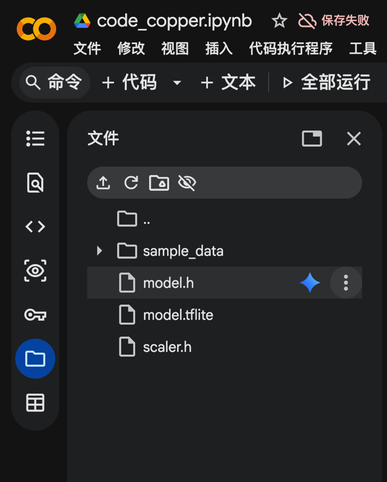

*图 4-13　在 Colab 文件面板中下载 `model.h`、`scaler.h` 两个头文件*

把两个文件拷进工程的 `src/` 目录，与 `main.cpp` 同级：

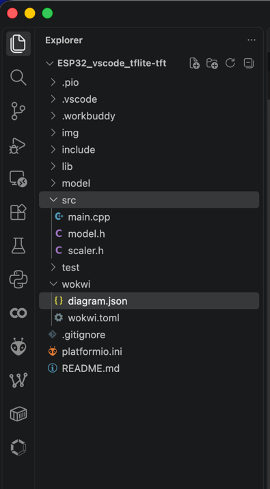

*图 4-14　`src/` 下应同时存在 `main.cpp`、`model.h`、`scaler.h`*

> ⚠️ 两个文件必须**同时**替换。只换模型不换 scaler，就是 §2.4 那个静默失败。

### 阶段 C：固件移植

**C1. `platformio.ini`**

```ini
[env:esp32dev]
platform = espressif32@6.6.0
board = esp32dev
framework = arduino
monitor_speed = 115200
lib_deps =
    spaziochirale/ArduTFLite@^1.0.2
    adafruit/Adafruit ILI9341@^1.6.0
    adafruit/Adafruit GFX Library@^1.11.11
```

`lib_deps` 也可以不写，改为在图形界面里手动装库（见 C2）；但**写进 `platformio.ini` 更可靠**，换机器时不用重装。

**C2. 安装依赖库**

打开 `PIO Home` → `Libraries`，搜索 `ArduTFLite`：

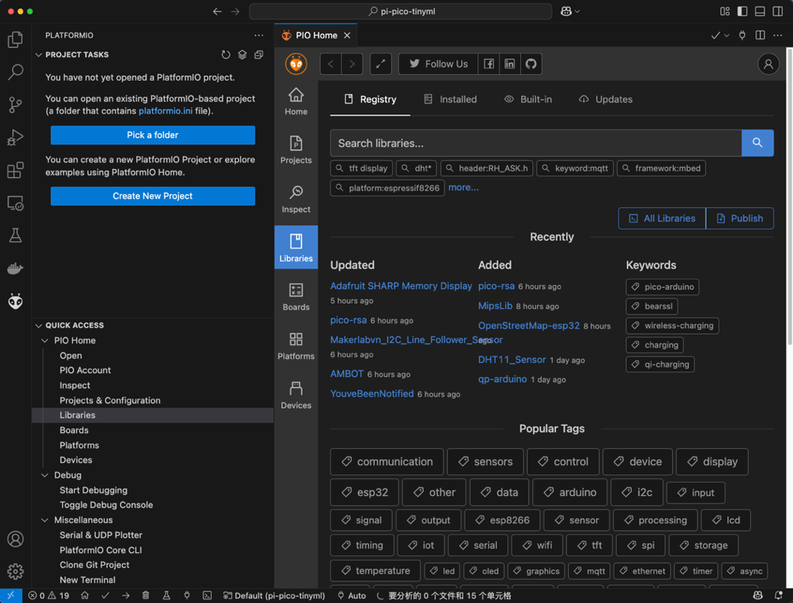

*图 4-15　PIO Home 里的 Libraries 入口*

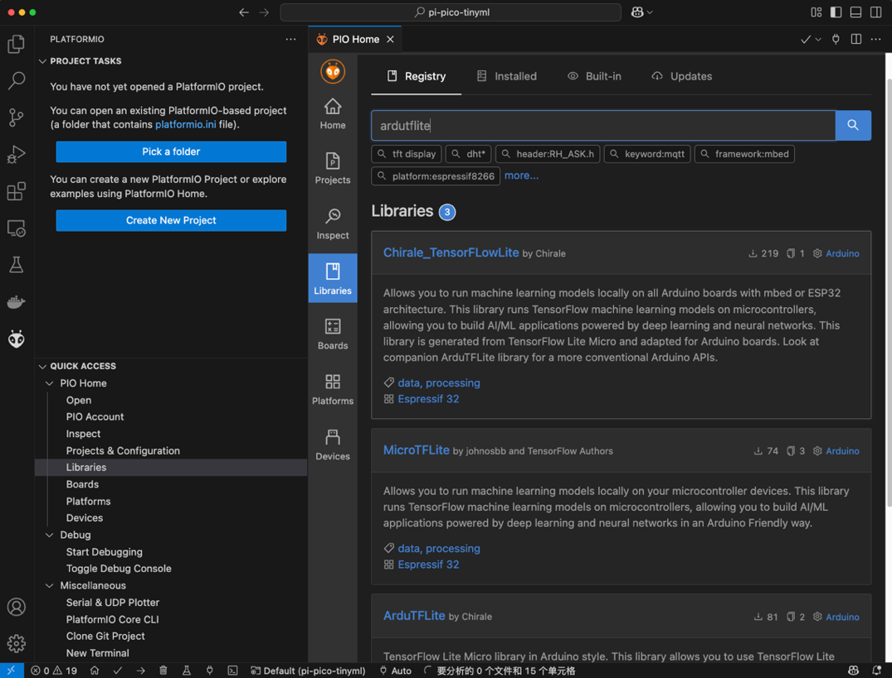

*图 4-16　搜索结果中的 ArduTFLite（spaziochirale 发布）*

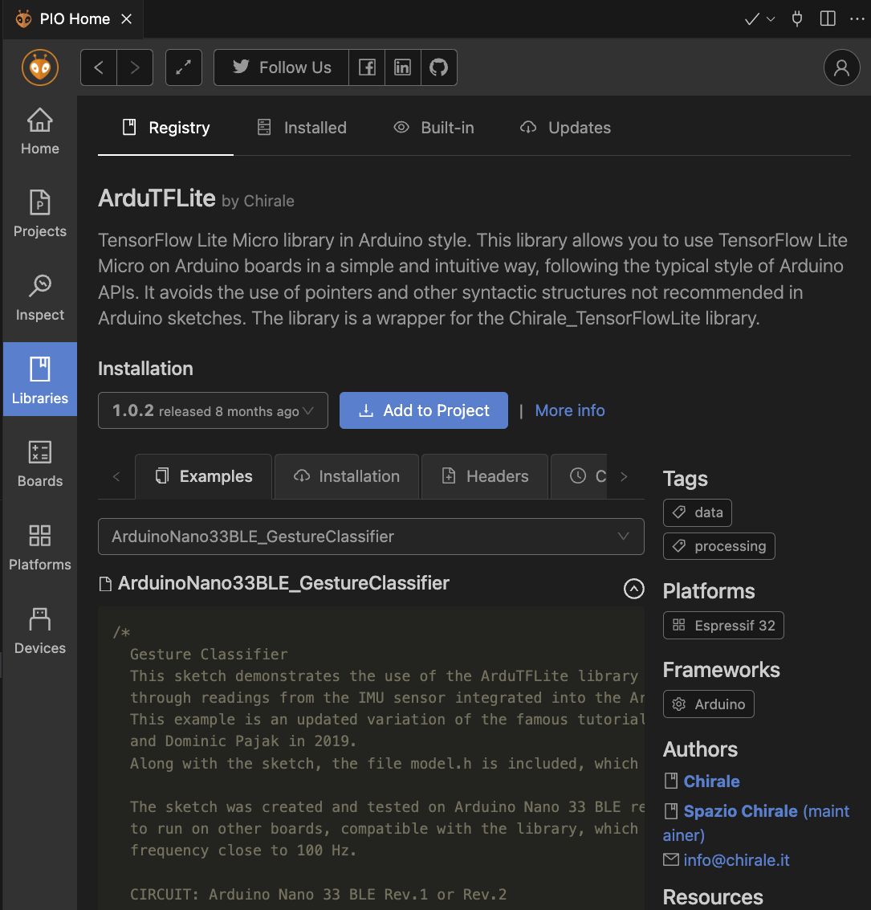

*图 4-17　进入详情页点 `Add to Project`，选择当前工程。Adafruit ILI9341 与 GFX 用同样方式安装*

> 三个库装完后 `platformio.ini` 的 `lib_deps` 会自动补全。若编译报找不到 `TensorFlowLite_ESP32`，说明 ArduTFLite 没装进本工程，回本节重装。

**C3. 固件六段结构**（对应 `src/main.cpp`）

| 段 | 内容 | 要点 |
|---|---|---|
| ① 引脚定义 | ADC / TFT / LED | 集中一处，便于换板 |
| ② 张量竞技场 | `alignas(16) byte tensorArena[16*1024]` | 太小则 `AllocateTensors` 失败 |
| ③ 归一化参数 | `#include "scaler.h"` | 禁止手抄 |
| ④ 类别表 | `CLASS_ID` / `CLASS_NAME` / `CLASS_COLOR` | 与 `num2label` 一致 |
| ⑤ 推理循环 | 采样→归一化→填张量→invoke→argmax | 见 §5.1 |
| ⑥ 输出 | 串口 CSV + TFT + LED | 见 §5.2 |

**C4. 三处必须与训练对齐的地方**

```cpp
analogReadResolution(10);                      // ① 量纲 0~1023
const float mean[2]  = INPUT_MEAN;             // ② 归一化同源
const float scale[2] = INPUT_SCALE;
if (modelGetOutput(NUM_CLASSES - 1) < 0) {     // ③ 类别数自检
  /* 停机报错：模型不是四分类版本 */
}
```

第三处是**开机自检**：库函数索引越界会返回 -1，而 softmax 输出恒 ≥ 0，所以只要读到 -1 就说明 `model.h` 拿错了版本。

### 阶段 D：电路连接与仿真

**D1. 接线表**

| 器件引脚 | ESP32 引脚 | 线色建议 | 说明 |
|---|---|---|---|
| pot1（下）SIG | GPIO35 | 绿 | 特征 x（温度） |
| pot2（上）SIG | GPIO34 | 绿 | 特征 y（湿度） |
| pot1/pot2 VCC | 3V3 | 红 | 电位器供电 |
| pot1/pot2 GND | GND.1 | 黑 | |
| TFT VCC / LED | 3V3 | 红 | 背光与逻辑电源 |
| TFT GND | GND.3 | 黑 | |
| TFT CS | GPIO5 | 橙 | 片选 |
| TFT RST | GPIO4 | 紫 | 复位 |
| TFT D/C | GPIO21 | 黄 | 命令/数据 |
| TFT MOSI | GPIO23 | 绿 | SPI 数据 |
| TFT SCK | GPIO18 | 蓝 | SPI 时钟 |
| TFT MISO | GPIO19 | 灰 | 可不接（不回读时） |
| LED（经 1 kΩ） | GPIO2 | 绿 | 类别指示灯 |

> 电位器故意 **34 在上、35 在下** 对应 **上面电位器接 34**，两根信号线平行不交叉。这与图 0-1 一致：上方电位器标注「湿度」，下方标注「温度」。

**D2. `wokwi.toml` 指向构建产物**

见阶段 0.4，路径务必与 `platform` / `board` 对应的 `.pio/build/esp32dev/` 一致。

**D3. 构建与运行**

1. 编译：左下角 `√` 图标，或终端执行 `pio run -e esp32dev`
2. VS Code 命令面板（`Cmd/Ctrl+Shift+P`）→ `Wokwi: Start Simulator`
3. 打开串口监视器（Wokwi 面板里的终端，或 PlatformIO 的 Monitor）

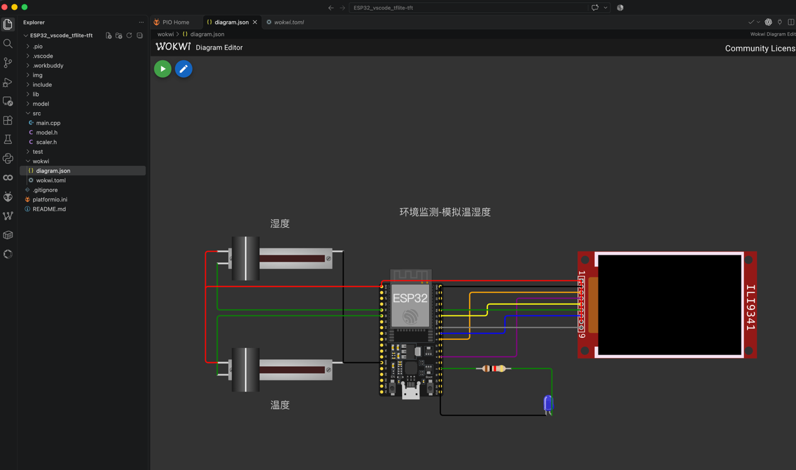

*图 4-18　点 Wokwi 面板左上角绿色三角启动仿真，电路通电、TFT 亮屏即成功*

首次构建会下载 ESP32 工具链与三个依赖库，耗时较长；之后再改代码只走增量编译，几秒即可。

**D4. 验证四类**

把两个电位器分别推到四个角落，屏上大字应依次出现四种类别：

| 电位器位置 | x（温度） | y（湿度） | 期望类别 |
|---|---|---|---|
| 左 + 上 | 小 | 大 | a 潮湿舒适 |
| 右 + 上 | 大 | 大 | b 潮湿闷热 |
| 左 + 下 | 小 | 小 | c 干燥舒适 |
| 右 + 下 | 大 | 小 | d 干燥偏热 |

> 本组模型的实测分界约为 **x ≈ 420、y ≈ 205**（每组数据不同，以自己训练出的边界为准；可在 Notebook 的决策区域图里读出）。

---

## 5. 关键代码解析

### 5.1 推理主路径

```cpp
const int v1 = analogRead(pin_adc_x);        // 0~1023
const int v2 = analogRead(pin_adc_y);

const float nx = (v1 - mean[0]) / scale[0];  // 归一化：与训练逐位一致
const float ny = (v2 - mean[1]) / scale[1];

modelSetInput(nx, 0);
modelSetInput(ny, 1);

const uint32_t t0 = micros();
modelRunInference();                          // 全连接 3 层 + softmax
const uint32_t infer_us = micros() - t0;

float probs[4];
for (int i = 0; i < 4; i++) probs[i] = modelGetOutput(i);
const int cls = argmax(probs, 4);             // 判据：取最大概率
```

注意 **`argmax` 而不是 `> 0.5`** —— 这是二分类思维最容易带进四分类的地方。

### 5.2 屏幕刷新策略

整屏重绘会闪。代码把界面拆成「不变」和「常变」两部分：

| 区域 | 内容 | 刷新时机 |
|---|---|---|
| 静态层 | 标题、四行类别字母、分隔线、图例 | 仅 `setup()` 一次 |
| 大字 | 当前类别 | **类别变化时**（用 `last_cls` 比较） |
| 概率条 | 四条长度 + 百分比 | 每帧 |
| 底栏 | 原始值 / 归一化值 / 推理耗时 | 每帧 |

右上角的 `r1` / `r3` 小字是**固件版本标记**，显示当前生效的屏幕旋转值。改了旋转常量但屏上标记没变，说明仿真还在跑旧固件 —— 调试方向问题时非常有用。

### 5.3 两个必须用硬件 SPI 的理由

```cpp
Adafruit_ILI9341 tft(tft_cs, tft_dc, tft_rst);   // ✅ 三参数 → 硬件 SPI
// Adafruit_ILI9341 tft(cs, dc, mosi, sck, rst, miso);  // ❌ 六参数 → 软件 SPI
SPI.begin(tft_sck, tft_miso, tft_mosi, tft_cs);  // 显式指定引脚
```

六参数构造函数会把 `connection` 设为 `TFT_SOFT_SPI`（GPIO 位翻转模拟 SPI），刷一屏要几十万次 `digitalWrite`，实际慢到不可用。

### 5.4 LED 亮度：ESP32 没有 `analogWrite`（core 2.x）

```cpp
#if ESP_ARDUINO_VERSION_MAJOR >= 3
  analogWrite(pin_led, duty);        // core 3.x
#else
  ledcSetup(0, 5000, 8);             // core 2.x：通道0，5kHz，8bit
  ledcAttachPin(pin_led, 0);
  ledcWrite(0, duty);
#endif
```

---

## 6. 故障排查

| # | 现象 | 原因 | 处理 |
|---|---|---|---|
| 1 | 生成 `firmware.bin` 时 `TypeError: '_Null' + 'str'` | `platform = espressif32` 未锁版本，解析到 7.x，与 PlatformIO Core 6.2.0 不兼容 | 锁 `espressif32@6.6.0` |
| 2 | 四个电位器位置都判成 a（或恒定一类） | 归一化参数与模型不配套 / ADC 仍是 12 bit | 检查 `scaler.h` 是否与 `model.h` 同批导出；确认 `analogReadResolution(10)` |
| 3 | Colab 上传后找不到 notebook | 传到了「我的云端硬盘」根目录 | 回 A2，放进 `Colab Notebooks` 文件夹 |
| 4 | 屏幕全白 / 初始化卡住 | 用了六参数构造函数（软件 SPI） | 改三参数 + `SPI.begin(...)` |
| 5 | 屏幕能亮但文字上下颠倒 / 侧躺 | 元件 `rotate` 与 `setRotation` 不匹配 | 见下方方向换算表 |
| 6 | 改了旋转/参数，屏上无变化 | Wokwi 未重新加载固件 | 停止仿真 → 重新 Build → 再启动；看右上角 `r?` 标记 |
| 7 | Wokwi 启动报找不到固件 | `wokwi.toml` 里 `firmware` 路径写错，或还没编译 | 确认是 `../.pio/build/esp32dev/firmware.bin`，且已成功 `pio run` |
| 8 | 仿真跑起来但电路是旧样子 | `diagram.json` 没保存 / 改在了别的目录 | 确认编辑的是工程下 `wokwi/diagram.json` |
| 9 | 插件装完 `PIO Home` 打不开 / 一直转圈 | PlatformIO 首次下载被打断，缓存损坏 | 关闭 VS Code，删 `~/.platformio/.cache/downloads/*.lock` 与 `~/.platformio/packages.lock` 后重开 |


### 屏幕方向换算表（Wokwi）

元件 `rotate` 与代码 `setRotation` 是**相减**关系，净方向 = `rotate − setRotation×90`：

| `diagram.json` rotate | `setRotation` | 净方向 |
|---|---|---|
| 0 | 0 | 0°（竖屏） |
| 90 | 1 | 0°，面板横向 ✅ |
| 90 | 3 | 180°（上下颠倒） |
| 270 | 3 | 0°，面板横向（排针朝右） |

---

## 7. 验收标准

| 项目 | 合格标准 |
|---|---|
| 环境 | `pio run -e esp32dev` 一次编译通过；Wokwi 能启动并串口有输出 |
| 训练 | 测试集 accuracy ≥ 0.95，混淆矩阵对角线占优 |
| 转换 | Keras 与 TFLite 输出最大偏差 < 1e-6 |
| 部署 | 串口输出 10 列 CSV，`p_a…p_d` 之和 ≈ 1.000 |
| 功能 | 四个角落分别稳定输出 a/b/c/d，屏上大字与含义对应 |
| 资源 | RAM < 30%，Flash < 60% |
| 文档 | 提交实验报告（见 §8） |

---

## 8. 实验报告要求

提交 PDF，包含以下内容：

1. **环境截图**：`PIO Home` 工程页 + `wokwi/` 目录结构 + 一次成功的编译输出。
2. **数据与模型**：四簇散点的截图、各类样本数、训练轮数与最终 loss/acc。
3. **评估图**：混淆矩阵 + 决策区域图各一张，并说明边界大致落在哪个坐标。
4. **本组参数表**：`mean`、`scale`、参数量、`model.tflite` 体积。
5. **部署截图**：TFT 显示四种类别各一张（共 4 张）。
6. **资源占用**：`pio run` 输出的 RAM / Flash 百分比。
7. **故障记录**：至少记录 1 个你实际遇到的问题、定位过程与解决办法。

---

## 9. 思考题

1. 如果把 `analogReadResolution` 改成 12 bit，而归一化参数不变，四类概率会怎样变化？为什么程序不会报错？
2. 本实验模型只有 388 个参数。若把隐藏层扩到 128/128，精度提升有限但 RAM/Flash 明显上升，请估算参数量并说明 MCU 端会有哪些新的瓶颈（不止是 RAM）。
3. `sparse_categorical_crossentropy` 与 `categorical_crossentropy` 的差别是什么？后者需要对 `y` 做什么预处理？
4. 若把 float32 模型换成 int8 全量化，需额外准备什么？输入侧要怎么配合（scale / zero_point）？
5. 为什么模型缓冲区要 `alignas(16)`？不加会出现什么现象，为什么这类 bug 难排查？
6. 若把两个电位器换成真实温湿度传感器（如 SHT30，返回 0~100%RH 与 -40~125℃），训练数据和固件的预处理各需要改哪些地方？
7. 屏幕刷新时为什么要区分"静态层/常变层"？如果每帧整屏重绘，除了闪烁还会带来什么代价？
8. `diagram.json` 与 `platformio.ini` 都属于"配置文件"。如果同学之间互相拷贝这两个文件，最可能出现的不兼容是什么？为什么 `wokwi.toml` 里的路径要用相对路径？

---

## 附录 A 串口输出格式

```
x,y,nx,ny,p_a,p_b,p_c,p_d,cls,label
834,233,1.810,0.324,0.002,0.985,0.010,0.003,b,WET HOT
```

| 字段 | 含义 |
|---|---|
| `x,y` | 原始 ADC 值（0~1023） |
| `nx,ny` | 归一化后的输入 |
| `p_a…p_d` | 四类概率（和为 1） |
| `cls` | argmax 得到的类别字母 |
| `label` | 类别英文名 |

可直接把串口日志存成 CSV，用 `pandas.read_csv` 复核；再和 Notebook 的决策区域图叠加，能直观看出仿真与训练的偏差。

## 附录 B 屏幕布局

```
┌────────────────────────────────────┐
│ TFLite 4-Class                 r1  │  ← 右上角 r?: 固件旋转标记
│                                    │
│           WET COMFORT              │  ← 当前类别（大字、按类上色）
│ ────────────────────────────────── │
│ a ██                       2%      │
│ b ███████████████████     91%      │  ← 四条概率条
│ c ██                       5%      │
│ d                          2%      │
│ ────────────────────────────────── │
│ raw  x=834  y=233                  │
│ norm x=1.81  y=0.32   infer 0.87 ms│
│ a wet-comfort  b wet-hot  c dry-comfort  d dry-hot │
└────────────────────────────────────┘
```

## 附录 C 关键参数速查（本组实测，供对照）

| 项目 | 数值 |
|---|---|
| `model.tflite` | 3744 B |
| 输入张量 | `[1, 2]` float32 |
| 输出张量 | `[1, 4]` float32 |
| `INPUT_MEAN` | `{413.77236980f, 197.79336877f}` |
| `INPUT_SCALE` | `{232.21609603f, 108.83203890f}` |
| 决策边界 | x ≈ 420，y ≈ 205 |
| RAM / Flash | 13.5% / 43.7% |

## 附录 D wokwi.toml 与 diagram.json 参考

`wokwi.toml`：

```toml
[wokwi]
version = 1
firmware = '../.pio/build/esp32dev/firmware.bin'
elf      = '../.pio/build/esp32dev/firmware.elf'
rfc2217ServerPort = 4000
```

`diagram.json` 由三部分组成：`parts`（元件清单与坐标）、`connections`（连线）、`version`。本工程已在 `wokwi/diagram.json` 中给出完整内容，要点如下：

| 元件 | Wokwi 类型 | 关键属性 |
|---|---|---|
| ESP32 开发板 | `board-esp32-devkit-c-v4` | 电源与 GPIO 引出 |
| 上方电位器（湿度） | `wokwi-potentiometer` | SIG → GPIO34 |
| 下方电位器（温度） | `wokwi-potentiometer` | SIG → GPIO35 |
| TFT 屏 | `wokwi-ili9341` | `rotate: 90`（配合 `setRotation(1)`） |

> 连线数组里每条 `connections` 的 `[]` 表示"由 Wokwi 自动布线"；显式写出 `["x1","y1","x2","y2",...]` 则可以精确控制走线，但元件一旦移动就会错位，因此推荐留空。
